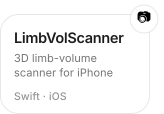
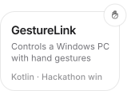
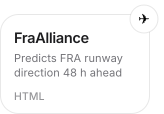
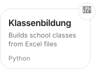
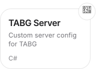

<picture><source media="(prefers-color-scheme: dark)" srcset="assets/header-dark.svg"></picture>

<a href="https://github.com/jonassneu/LimbVolScanner-Public"><picture><source media="(prefers-color-scheme: dark)" srcset="assets/limbvol-dark.svg"></picture></a><a href="https://github.com/jonassneu/GestureLink"><picture><source media="(prefers-color-scheme: dark)" srcset="assets/gesturelink-dark.svg"></picture></a><a href="https://github.com/jonassneu/fraalliance-hackmeck"><picture><source media="(prefers-color-scheme: dark)" srcset="assets/fraalliance-dark.svg"></picture></a><a href="https://github.com/jonassneu/klassenbildung-go-local"><picture><source media="(prefers-color-scheme: dark)" srcset="assets/klassenbildung-dark.svg"></picture></a><a href="https://github.com/jonassneu/TABG-Server-Installer"><picture><source media="(prefers-color-scheme: dark)" srcset="assets/tabg-dark.svg"></picture></a>

